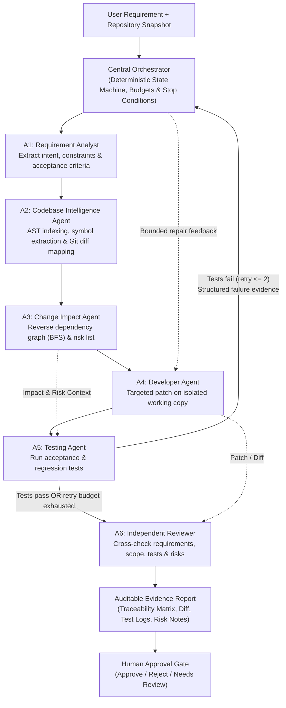

# ChangeGuard AI

**A Multi-Agent Framework for Requirement-Aware Software Change Impact Analysis, Automated Patch Generation and Regression Verification**


| Field | Details |
| :--- | :--- |
| **Project Name** | ChangeGuard AI |
| **Team** | BJM-SLIIT |
| **University** | Sri Lanka Institute of Information Technology (SLIIT) |
| **Competition** | Innodata AI Catalyst 2026 — University Track |
| **Domain** | AI and Robotic Engineering |
| **Repository** | https://github.com/marshadmajeedh/BJM-SLIIT |
| **Phase 1 MVP Target** | 29 November 2026 |
| **Current Development Status** | Proposal completed; repository scaffolded on `main`; static codebase intelligence and reverse dependency impact prototype implemented on unmerged branch `origin/feature/mujahidh-codebase`; orchestration, patch generation, testing, review, UI, and benchmarks in progress. |

---

## Table of Contents

1. [Project Overview](#project-overview)
2. [Problem Statement](#problem-statement)
3. [Proposed Solution](#proposed-solution)
4. [Key Features](#key-features)
5. [System Architecture](#system-architecture)
6. [Multi-Agent Components](#multi-agent-components)
7. [Technology Stack](#technology-stack)
8. [End-to-End Workflow](#end-to-end-workflow)
9. [Demonstration Scenario](#demonstration-scenario)
10. [Repository Structure](#repository-structure)
11. [Getting Started](#getting-started)
12. [Testing and Validation](#testing-and-validation)
13. [Single-Agent vs Multi-Agent Evaluation](#single-agent-vs-multi-agent-evaluation)
14. [Security and Safety](#security-and-safety)
15. [Current Implementation Status](#current-implementation-status)
16. [Project Limitations](#project-limitations)
17. [Team Contributions](#team-contributions)
18. [Roadmap](#roadmap)
19. [Documentation](#documentation)
20. [AI Usage and Acknowledgements](#ai-usage-and-acknowledgements)

---

## Project Overview

**ChangeGuard AI** is a requirement-aware software change assurance framework designed to bridge the gap between generating code and proving that a proposed change is safe, scoped, and aligned with user intent. Unlike standalone AI code generators that output unverified patches directly, ChangeGuard AI is designed to connect natural-language requirements, affected source modules, scoped code diffs, automated acceptance and regression test evidence, and explicit human approval into a single auditable workflow.

### Research Question

> *Can a requirement-traceable multi-agent workflow produce more verifiably correct software changes than a comparable single-agent workflow under similar task, model, and resource conditions?*

### Intended Capabilities vs. Current Implementation

- **Intended Phase 1 MVP Scope:** Ingest a local Python repository snapshot and a natural-language change request; decompose the requirement into structured acceptance criteria; analyze static symbols and reverse dependencies; generate a minimally scoped patch on an isolated working copy; run acceptance and regression tests with bounded repair retries; perform an independent evidence review; and present an approval-ready change package via a web dashboard alongside a fair single-agent baseline comparison.
- **Currently Implemented (Verified in Repository):**
  - On `main` / `docs/update-project-readme`: The official project proposal (`docs/Proposal.docx`) and team directory scaffolding (`project/`, `frontend/`, `sample_projects/mini_pos/`, `tests/`).
  - On unmerged branch `origin/feature/mujahidh-codebase`: A working Python static analysis core covering AST repository indexing (`analyzer.py`), Git diff-to-function mapping (`git_diff_analyzer.py`), BFS reverse-dependency impact analysis (`impact_agent.py`), a composite runner (`codebase_agent.py`), and a 5-module miniature POS testbed (`sample_projects/mini_pos/`).
  - All other agents (Requirement Analyst, Developer, Testing, Independent Reviewer), the deterministic orchestrator, FastAPI backend, React dashboard, automated test suites, and benchmark runs remain under development or planned.

---

## Problem Statement

Modern software teams increasingly adopt AI-assisted coding tools—GitHub's 2026 Octoverse reports rapid growth in agent-drafted pull requests, while Google Cloud's 2024 DORA report observed that increased AI adoption without corresponding verification discipline can correlate with lower software-delivery stability. Generating a syntactically plausible patch is not equivalent to verifying software correctness.

Key failure modes in unverified AI-generated software changes include:

- **Misinterpreted requirements:** Natural-language requests often contain implicit constraints and edge cases that single-pass prompts overlook or misread.
- **Hidden dependencies:** A localized edit in one module (e.g., billing logic) can silently propagate behavioral changes to direct and transitive dependents (e.g., refunds, reports, customer service, dashboards).
- **Unexpected regressions:** Locally valid patches frequently break previously working functionality in adjacent or downstream code paths.
- **Unnecessary code modifications:** Unconstrained AI editors may refactor unrelated files, inflate diff size, and complicate human code review.
- **Insufficient testing:** Generated patches are often delivered without requirement-specific acceptance tests or regression verification against existing test suites.
- **Lack of traceability:** Reviewers rarely receive structured links connecting each requirement criterion to exact modified lines, impacted files, and test outcomes.
- **Unverified AI-generated patches:** Without independent review and explicit approval gates, defective or incomplete patches can reach protected branches.

---

## Proposed Solution

ChangeGuard AI addresses these challenges by treating software modification as an **evidence-producing assurance pipeline** rather than open-ended code generation:

1. **Coordinated Specialist Agents:** Splits requirement interpretation, static codebase discovery, dependency impact estimation, patch authoring, automated testing, and adversarial review into six distinct roles to reduce role interference.
2. **Deterministic Orchestration:** Uses a central state-machine orchestrator to control handoffs, enforce structured schemas, track execution budgets, and cap repair iterations.
3. **Structured Evidence & Traceability:** Replaces untracked free-form agent chat with structured artifacts (task IDs, requirement criteria, dependency paths, unified diffs, test logs, and unresolved risk notes).
4. **Isolated Changes:** Applies proposed patches to an isolated working copy (e.g., temporary Git branch or worktree) so the protected `main` branch remains untouched.
5. **Automated Acceptance & Regression Verification:** Runs both new requirement-aligned tests and existing regression tests, returning structured failure feedback to the developer agent within a strict retry bound (maximum 2 repair iterations).
6. **Independent Review & Human Oversight:** Requires an independent reviewer agent to cross-check scope, requirements, and test evidence, followed by mandatory human approval before any change is accepted or merged.

---

## Key Features

The table below distinguishes between features available on the current branch, features implemented on unmerged feature branches, and planned MVP capabilities.

| Feature | Description | Status | Branch / Evidence |
| :--- | :--- | :--- | :--- |
| **Natural-language requirement analysis** | Parse free-text change requests to extract intent, constraints, assumptions, and edge cases. | Planned | `docs/Proposal.docx` (Sec. 4–5); scaffold at `project/marsadh_orchestrator/` |
| **Structured acceptance criteria generation** | Convert user intent into testable, traceable acceptance criteria records. | Planned | `docs/Proposal.docx` (Sec. 4–5); scaffold at `project/schemas/` |
| **AST-based codebase intelligence** | Parse Python files via built-in `ast` to extract functions, classes, and imports without executing target code. | Implemented (unmerged branch) | `origin/feature/mujahidh-codebase`: `analyzer.py`, `git_diff_analyzer.py` |
| **Dependency graph construction** | Build an in-memory reverse import dependency graph across repository Python modules. | Implemented (unmerged branch) | `origin/feature/mujahidh-codebase`: `impact_agent.py` |
| **Transitive change impact analysis** | Traverse reverse dependencies via BFS to classify direct (depth 1) and indirect (depth > 1) impacted files with import line citations. | Implemented (unmerged branch) | `origin/feature/mujahidh-codebase`: `impact_agent.py`, `codebase_agent.py` |
| **Risk identification** | Surface affected modules, unresolved assumptions, and regression risk areas for review. | Partially implemented (unmerged branch) | Direct/indirect impact lists implemented on `origin/feature/mujahidh-codebase`; LLM risk scoring planned |
| **Targeted patch generation** | Produce minimally scoped Git diffs in an isolated working copy addressing the acceptance criteria. | Planned | `docs/Proposal.docx` (Sec. 5) |
| **Automated acceptance testing** | Generate and run requirement-specific tests verifying the requested behavior. | Planned | Scaffold at `project/agents/munshif_testing/`, `tests/` |
| **Regression verification** | Execute pre-existing test suites to detect unintended breakage in impacted and non-impacted modules. | Planned | Scaffold at `project/agents/munshif_testing/`, `tests/` |
| **Bounded repair iterations** | Route failing test evidence back to the developer agent for up to 2 repair attempts before escalating. | Planned | `docs/Proposal.docx` (Sec. 5) |
| **Independent review** | Cross-check requirements, patch scope, test coverage, and limitations before emitting a recommendation. | Planned | Scaffold at `project/nafris_verification/` |
| **Human approval** | Mandatory human review gate before any commit or merge into protected branches. | Planned | `docs/Proposal.docx` (Sec. 3, 5, 9) |
| **Auditable change reports** | Package requirement-to-file-to-test traces, Git diffs, test logs, and reviewer notes for inspection. | Planned | `docs/Proposal.docx` (Sec. 3, 4); JSON impact output implemented on `origin/feature/mujahidh-codebase` |
| **Single-agent comparative benchmarking** | Compare the multi-agent workflow against an equivalent single-agent baseline under controlled budgets and metrics. | Planned | `docs/Proposal.docx` (Sec. 8) |

---

## System Architecture

The diagram below illustrates the **proposed end-to-end multi-agent architecture** from `docs/Proposal.docx`, including the bounded testing-to-patch repair loop (maximum 2 iterations) and the mandatory human approval gate.



### Proposed vs. Currently Implemented Workflow

- **Proposed Architecture (Above):** Six coordinated agents orchestrated via a deterministic state machine, supporting requirement-driven patch generation, isolated test execution, bounded repair retries, independent review, and a web dashboard.
- **Currently Implemented Pipeline (`origin/feature/mujahidh-codebase` only):** A standalone static analysis pipeline (`run_codebase_agent`) that indexes a Python source directory using `ast`, reads local Git changes via `git diff --unified=0`, maps modified lines to AST function definitions, and computes direct and transitive reverse-dependency impact using BFS, outputting a structured JSON report. It currently analyzes existing Git diffs rather than LLM-generated patches.

---

## Multi-Agent Components

### Specialist Agents

| Agent | Responsibility | Input | Output | Implementation Status |
| :--- | :--- | :--- | :--- | :--- |
| **A1: Requirement Analyst** | Decompose natural-language change requests into structured intent, constraints, assumptions, edge cases, and testable acceptance criteria. | Natural-language change request, repository metadata | Structured requirement specification & acceptance criteria | **Planned** (scaffold: `project/marsadh_orchestrator/`) |
| **A2: Codebase Intelligence Agent** | Index repository files, functions, classes, and imports using AST parsing; map Git diff lines to affected functions. | Repository path, source directory, Git base ref | Repository symbol inventory, changed files, lines, and functions | **Implemented on unmerged branch** (`origin/feature/mujahidh-codebase`: `analyzer.py`, `git_diff_analyzer.py`, `codebase_agent.py`); **Not on `main`** |
| **A3: Change Impact Agent** | Construct reverse import dependency graph, compute direct/indirect transitive dependents, and estimate regression targets and risk. | Indexed repository files, changed file(s), requirement context | Impact graph, direct/indirect impacted file list with import lines, risk summary | **Partially implemented on unmerged branch** (`origin/feature/mujahidh-codebase`: `impact_agent.py` implements static BFS reverse dependency impact; LLM risk ranking planned); **Not on `main`** |
| **A4: Developer Agent** | Generate a minimally scoped code patch in an isolated working copy to satisfy acceptance criteria while avoiding unrelated edits. | Acceptance criteria, relevant code context, impact list, optional test failure feedback | Scoped Git diff / patch on isolated working copy, edit history | **Planned** |
| **A5: Testing Agent** | Synthesize requirement-aligned acceptance tests and execute acceptance + existing regression test suites in isolation. | Acceptance criteria, impact targets, isolated patched working copy | Structured pass/fail test logs, regression summary, failure diagnostics | **Planned** (scaffold: `project/agents/munshif_testing/`) |
| **A6: Independent Reviewer** | Adversarially cross-check acceptance criteria against the generated diff, patch scope, test coverage, and unresolved limitations. | Requirement specification, Git diff, impact report, test evidence | Review recommendation (`Approve` / `Needs Review` / `Reject`) and unresolved risk notes | **Planned** (scaffold: `project/nafris_verification/`) |

### Central Orchestrator Responsibilities

The central orchestrator (`project/marsadh_orchestrator/`, currently scaffolded) is designed to govern the entire workflow deterministically:

- **Structured Agent Communication:** Enforces typed JSON/Pydantic records across handoffs (task ID, inputs, outputs, evidence references, status, and confidence/uncertainty notes) rather than untracked free-form chat.
- **State Management:** Maintains a deterministic state machine tracking the current stage, artifact lineage, and audit trail for each change request.
- **Execution Budgets:** Enforces limits on token usage, API spend, tool timeouts, and repair iterations (capped at a maximum of **2** repair loops in the MVP).
- **Stop Conditions:** Terminates cleanly on verified success, exhausted retry budget, timeout, or safety violation, surfacing `"needs review"` when behavior is unverified or reviewer disagreement occurs rather than silently accepting changes.

---

## Technology Stack

Confirmed dependencies reflect code actually verified in the repository (`origin/feature/mujahidh-codebase`). Planned technologies come from `docs/Proposal.docx` and have not yet been installed or integrated into `project/requirements.txt`.

| Layer | Confirmed (Verified in Code) | Planned (Proposal / Scaffolding) | Notes |
| :--- | :--- | :--- | :--- |
| **Frontend** | *None implemented* | React + Tailwind CSS | Directory scaffolded at `frontend/.gitkeep` |
| **Backend** | *None implemented* | Python + FastAPI + Pydantic | Empty stub at `project/main.py`; scaffold at `project/schemas/` |
| **Agent Orchestration** | Custom Python runner (`codebase_agent.py` on `origin/feature/mujahidh-codebase`) | LangGraph or equivalent bounded state-machine workflow | Scaffold at `project/marsadh_orchestrator/` |
| **LLM Integration** | *None implemented* | Configurable LLM API (provider selected by access, pricing, and constraints) | Model provider and version will be logged per experiment |
| **Static Code Analysis** | Python standard library `ast`, `pathlib`, `re` | Same (`ast` + extended symbol analysis) | Zero third-party dependencies in current prototype |
| **Dependency Analysis** | Custom reverse adjacency graph + `collections.deque` BFS (`impact_agent.py`) | Optional NetworkX graph analytics | Currently supports absolute Python imports |
| **Version Control** | Host Git CLI via Python `subprocess.run` (`git diff --unified=0`) | Git isolated branches / temporary worktrees; optional GitHub API | Verified in `git_diff_analyzer.py` on `origin/feature/mujahidh-codebase` |
| **Testing** | *None implemented* | `pytest` | Scaffold at `tests/.gitkeep` and `project/agents/munshif_testing/` |
| **Data Storage** | Structured JSON stdout/dict outputs | SQLite + structured JSON execution logs | Planned for audit trails and benchmark logging |
| **Execution Isolation** | Path containment validation (`Path.is_relative_to`) | Temporary Git branches/worktrees (working-copy isolation); optional Docker sandbox with resource/time limits | Worktrees isolate files only, not OS execution |

---

## End-to-End Workflow

The target ChangeGuard AI workflow consists of 11 explicit stages:

1. **Submit a repository and change requirement:** A developer or reviewer provides a local Python repository snapshot and a natural-language change request.
2. **Extract acceptance criteria:** The Requirement Analyst (A1) decomposes the request into structured acceptance criteria, assumptions, constraints, and edge cases.
3. **Analyze the repository:** The Codebase Intelligence Agent (A2) parses Python files via AST to index modules, functions, classes, and import relationships.
4. **Identify potentially affected modules:** The Change Impact Agent (A3) builds a reverse dependency graph, computes direct and transitive dependents, and ranks regression targets.
5. **Generate a targeted patch:** The Developer Agent (A4) authors a minimally scoped code diff aimed strictly at satisfying the acceptance criteria.
6. **Apply the patch to an isolated working copy:** The orchestrator applies the diff to a temporary isolated branch or Git worktree without altering `main`.
7. **Run acceptance and regression tests:** The Testing Agent (A5) runs requirement-specific acceptance tests alongside the repository's pre-existing regression test suite.
8. **Perform bounded repair attempts if necessary:** If tests fail, structured failure logs are returned to the Developer Agent for up to 2 bounded repair iterations.
9. **Independently review the evidence:** The Independent Reviewer (A6) cross-checks the acceptance criteria, diff scope, impacted modules, test logs, and remaining risks.
10. **Produce an auditable change package:** The system compiles a traceable report containing requirement-to-code-to-test links, the unified Git diff, test output, and risk notes.
11. **Present the result for human approval:** A human reviewer inspects the evidence package and explicitly decides whether to approve, request revisions, or reject the change.

---

## Demonstration Scenario

> **Important Clarification:** The miniature Point-of-Sale (POS) application (`sample_projects/mini_pos/`) is a **demonstration and evaluation testbed**, not the ChangeGuard AI product itself. ChangeGuard AI is a general-purpose software change assurance framework for Python repositories; a second, unrelated small Python repository (e.g., low-stock alert logic) is planned to test generalization beyond the POS example.

### Sample Change Request (from Proposal)

> *"Apply a 10% discount to premium customers only, without affecting regular checkout, inventory, payments, or reports."*

### Expected Behavior Specification (Illustrative — Planned Test Scenarios)

*Note: The table below defines the planned verification expectations from `docs/Proposal.docx`. Automated execution results are not yet recorded.*

| Test Scenario | Expected Behavior |
| :--- | :--- |
| Premium order, subtotal LKR 10,000 | 10% discount (LKR 1,000); payable total LKR 9,000 (before separately specified taxes) |
| Regular order, subtotal LKR 10,000 | No premium discount; payable total LKR 10,000 (before separately specified taxes) |
| Inventory item quantity 2 sold | Stock decreases by 2 as before |
| Payment record | Charged amount matches the correctly calculated checkout total |
| Sales report | Uses the intended payable amount without applying duplicate discounts |

### Walkthrough of the Scenario in ChangeGuard AI

- **Requirement Decomposition (Planned — A1):** Extracts customer-tier condition (`premium` vs. non-premium), discount percentage (`10%`), and non-regression invariants (regular checkout, inventory deduction, payment totals, and sales reporting).
- **Potentially Affected Modules (Partially Verified on `origin/feature/mujahidh-codebase`):**
  - *Proposal baseline modules:* `customers.py`, `billing.py`, `inventory.py`, `payments.py`, and `reports.py`.
  - *Current `mini_pos` prototype on `origin/feature/mujahidh-codebase`:* Contains `billing.py`, `refunds.py`, `reports.py`, `customer_service.py`, and `dashboard.py`. When `billing.py` is modified, `impact_agent.py` statically identifies `refunds.py` and `reports.py` as **direct** dependents (depth 1) and `customer_service.py` (depth 2) and `dashboard.py` (depth 3) as **indirect** transitive dependents.
- **Patch Generation (Planned — A4):** Scopes edits to discount calculation logic in `billing.py` without modifying unrelated modules unless required for consistency.
- **Acceptance Tests (Planned — A5):** Verifies premium discount calculation (LKR 10,000 → LKR 9,000) and regular checkout invariance (LKR 10,000 → LKR 10,000).
- **Regression Tests (Planned — A5):** Runs pre-existing tests across inventory, payments, refunds, and sales reporting to confirm no duplicate discounts or broken downstream behavior.
- **Final Evidence Report (Planned — A6):** Outputs the requirement-to-code-to-test trace, unified diff, test execution logs, unresolved risk notes, and reviewer recommendation for human approval.

---

## Repository Structure

### Current Branch (`docs/update-project-readme` / `main`)

```text
BJM-SLIIT/
├── .gitignore                          # Ignores Word temp files, __pycache__, *.pyc, .venv, .env
├── README.md                           # Project documentation (this file)
├── docs/
│   ├── PROJECT_DETAILS.md              # Competition project details (placeholder; 0 bytes)
│   ├── Proposal.docx                   # Official Innodata AI Catalyst 2026 proposal
│   └── Workflow.md                     # Workflow documentation (placeholder; 0 bytes)
├── frontend/
│   └── .gitkeep                        # Planned React + Tailwind CSS dashboard
├── project/
│   ├── main.py                         # Planned FastAPI backend entry point (placeholder; 0 bytes)
│   ├── requirements.txt │              # Empty placeholder (note: trailing Unicode '│' character in filename)
│   ├── agents/
│   │   ├── mujahidh_codebase/
│   │   │   └── .gitkeep                # Codebase intelligence & impact analysis module directory
│   │   └── munshif_testing/
│   │       └── .gitkeep                # Testing agent module directory
│   ├── marsadh_orchestrator/
│   │   └── .gitkeep                    # Orchestrator & requirement analysis module directory
│   ├── nafris_verification/
│   │   └── .gitkeep                    # Independent verification & reviewer module directory
│   └── schemas/
│       └── .gitkeep                    # Planned structured inter-agent Pydantic schemas
├── sample_projects/
│   └── mini_pos/
│       └── .gitkeep                    # Miniature POS demonstration repository directory
└── tests/
    └── .gitkeep                        # Planned unit, integration, and regression tests
```

### Additional Files on Unmerged Branches (Not Yet on `main`)

- **`origin/feature/mujahidh-codebase`**:
  - `project/agents/mujahidh_codebase/__init__.py`
  - `project/agents/mujahidh_codebase/analyzer.py` — AST repository analyzer
  - `project/agents/mujahidh_codebase/git_diff_analyzer.py` — Git diff parser and AST function mapper
  - `project/agents/mujahidh_codebase/impact_agent.py` — Reverse dependency graph and BFS impact analyzer
  - `project/agents/mujahidh_codebase/codebase_agent.py` — Composite static codebase intelligence runner
  - `sample_projects/mini_pos/{billing.py, refunds.py, reports.py, customer_service.py, dashboard.py}` — 5-file POS testbed
- **`docs/project-understanding-documents`**:
  - `docs/project-understanding/` — 10 architectural and onboarding markdown documents (`ARCHITECTURE.md`, `CODEBASE_MAP.md`, `COMPONENT_GUIDE.md`, `DEVELOPER_GUIDE.md`, `LLM_CONTEXT.md`, `PROJECT_OVERVIEW.md`, `PROPOSAL_VS_IMPLEMENTATION.md`, `STUDENT_EXPLANATION.md`, `TECHNOLOGY_STACK.md`, `WORKFLOWS.md`).

---

## Getting Started

### Prerequisites

- **Python 3.10+** (verified on Python 3.14.3; current static analysis prototype uses only the Python standard library)
- **Git CLI** (available on `PATH`, required by `git_diff_analyzer.py`)

### 1. Clone the Repository

```bash
git clone https://github.com/marshadmajeedh/BJM-SLIIT.git
cd BJM-SLIIT
```

### 2. Create and Activate a Virtual Environment

**Windows (PowerShell):**
```powershell
python -m venv .venv
.\.venv\Scripts\Activate.ps1
```

**Linux / macOS:**
```bash
python3 -m venv .venv
source .venv/bin/activate
```

### 3. Install Dependencies

`project/requirements.txt` is currently empty on `main` (and currently named `project/requirements.txt │` with a trailing Unicode character). The implemented static analysis prototype on `origin/feature/mujahidh-codebase` uses **only Python standard library modules** (`ast`, `collections`, `json`, `pathlib`, `re`, `subprocess`) and requires no third-party packages at this stage.

Once dependencies are added to a normalized `project/requirements.txt`, install them with:

```bash
pip install -r project/requirements.txt
```

### 4. Environment Variable Configuration

No API keys are required to run the current static analysis prototype. For upcoming LLM-powered agents (A1, A4, A6), create a local `.env` file (already listed in `.gitignore`; never commit secrets):

```env
LLM_PROVIDER=<your_provider_name>
LLM_MODEL=<your_model_name>
LLM_API_KEY=<your_api_key_here>
```

### 5. Backend and Frontend Startup Status

- **Backend (`project/main.py`):** Currently a 0-byte placeholder. FastAPI server startup commands will be documented once endpoints are implemented.
- **Frontend (`frontend/`):** Currently scaffolded with `.gitkeep` only. React + Tailwind CSS setup and startup instructions will be added once the dashboard is initialized.

### 6. Running Implemented Components (`origin/feature/mujahidh-codebase`)

To run the currently implemented static codebase intelligence and impact analysis modules, check out the `feature/mujahidh-codebase` branch first:

```bash
git fetch origin
git checkout origin/feature/mujahidh-codebase
```

Then run individual components from the repository root:

**Windows (PowerShell) and Linux / macOS:**
```bash
# 1. Index Python files, functions, classes, and imports in sample_projects/mini_pos
python project/agents/mujahidh_codebase/analyzer.py

# 2. Compute direct and transitive reverse-dependency impact for billing.py
python project/agents/mujahidh_codebase/impact_agent.py

# 3. Map uncommitted local Git diff lines to affected Python functions
python project/agents/mujahidh_codebase/git_diff_analyzer.py

# 4. Run the composite Codebase Intelligence Agent over local Git changes in sample_projects/mini_pos
python project/agents/mujahidh_codebase/codebase_agent.py
```

*Note: `git_diff_analyzer.py` and `codebase_agent.py` inspect uncommitted changes against `HEAD` (`git diff --unified=0`). If the working tree is clean, `reports` will be an empty list until a file under `sample_projects/mini_pos/` is modified.*

---

## Testing and Validation

Automated test suites are **planned** for Phase 1 (`tests/` and `project/agents/munshif_testing/` are currently scaffolded placeholders). The validation strategy defined in `docs/Proposal.docx` covers:

- **Unit Testing:** Verify individual ChangeGuard AI modules (AST parser, Git diff line mapper, reverse dependency BFS traversal, schema validation, and orchestrator state transitions).
- **Acceptance Testing:** Generate and execute requirement-specific tests verifying that every extracted acceptance criterion passes on the patched working copy.
- **Regression Testing:** Run pre-existing repository test suites to confirm unchanged modules and existing behaviors remain intact.
- **Integration Testing:** Validate end-to-end handoffs across the orchestrator, agents, isolated working copies, and evidence report generator.
- **Independent Test Cases:** Evaluate on at least five curated Python change scenarios spanning `sample_projects/mini_pos` and an independent second Python repository (with reserved unseen cases where practical) to guard against overfitting to the POS demo.
- **Repair Iteration Limits:** Strictly cap automated test-failure repair loops at **2 iterations** to prevent infinite retries and uncontrolled API spend.
- **Test Evidence Collection:** Persist structured pass/fail logs, unified diffs, exit codes, and trace links as part of the final change package.
- **Reproducibility:** Record repository commit hashes, task IDs, model identifiers, prompt configurations, and timeout/budget settings for every run.

### Test Execution Command (Planned)

Once `pytest` and test files are added under `tests/`, tests will be executed via:

```bash
pytest tests/
```

---

## Single-Agent vs Multi-Agent Evaluation

To answer the core research question rigorously, ChangeGuard AI includes a planned controlled benchmark comparing the **coordinated multi-agent workflow** against a **single-agent baseline**.

### Fair Comparison Protocol

Both systems will be evaluated under equivalent conditions:
- Identical repository snapshots (recorded by Git commit hash) and curated Python change tasks
- Same underlying LLM model and version where feasible
- Identical allowed toolset and test split (acceptance + regression tests)
- Comparable maximum token/spend budgets, fixed retry limits, and consistent execution timeouts
- Documented prompts and runtime settings, repeated across multiple runs where time and API quotas permit

### Evaluation Metrics

| Metric | Measurement Method |
| :--- | :--- |
| **Task success rate** | Percentage of change requests passing all pre-defined acceptance tests |
| **Requirement correctness** | Alignment of implemented behavior with extracted acceptance criteria and edge cases |
| **Regression safety** | Percentage of previously passing tests that continue to pass after patching |
| **Patch scope** | Number of unnecessary files modified and overall diff size |
| **Traceability coverage** | Proportion of acceptance criteria explicitly linked to modified code and test evidence |
| **Execution duration** | Wall-clock time from request submission to final evidence report |
| **Token consumption** | Total prompt and completion tokens consumed across all agent calls |
| **API cost** | Estimated API spend per completed task |
| **Failure recovery** | Handling of invalid patches, retry recovery rate, and timeout frequency |

### Current Benchmark Status

> **Evaluation Results: Pending.** No single-agent or multi-agent benchmark experiments have been executed yet. All reported metrics will be explicitly labeled as **measured** once verifiable experiment artifacts (task definitions, commit hashes, agent traces, Git diffs, test logs, runtime, token usage, and estimated cost) are committed.

---

## Security and Safety

ChangeGuard AI operates on source code repositories and executes developer tooling, making defense-in-depth essential. The table below clearly distinguishes **verified controls** currently in code from **planned controls** required for the full MVP.

| Control / Risk Area | Intended Protection | Current Status |
| :--- | :--- | :--- |
| **Restricted filesystem access** | Validate paths against repository root and reject path traversal (`..` or absolute paths). | **Partially implemented** on `origin/feature/mujahidh-codebase` (`Path.is_relative_to` in `codebase_agent.py`; traversal check in `impact_agent.py`) |
| **Command allowlisting** | Invoke only explicit allowlisted commands via `subprocess.run` argument lists (never `shell=True`). | **Partially implemented** on `origin/feature/mujahidh-codebase` (`git_diff_analyzer.py` uses `subprocess.run(["git", ...])` without `shell=True`) |
| **Secret protection** | Keep `.env` excluded in `.gitignore`, never commit API keys, and minimize logged source content. | **Partially implemented** (`.env` in `.gitignore`; log redaction planned) |
| **Isolated working copies** | Apply patches in temporary Git branches or worktrees so the original working tree is untouched. *(Note: Git worktrees provide **working-copy isolation only**, not operating-system-level execution isolation or security sandboxing.)* | **Planned** |
| **OS-level execution isolation** | Run untrusted target repository tests inside a constrained container/sandbox (e.g., Docker) and forbid automatic execution of arbitrary dependency-install scripts on the host. | **Planned** |
| **Execution timeouts & resource limits** | Enforce wall-clock timeouts and CPU/memory bounds on subprocesses and test runs. | **Planned** |
| **Bounded repair attempts** | Cap automated repair loops at a maximum of 2 iterations to prevent runaway execution or cost. | **Planned** |
| **Human approval & protected `main` branch** | Require explicit human sign-off before committing or merging any proposed change; never modify `main` automatically. | **Planned** |
| **No automatic production deployment** | Strictly out of scope; the system produces reviewable change packages only. | **Design constraint** |
| **Repository-based prompt injection risks** | Untrusted READMEs, comments, or source files may contain adversarial instructions; mitigate via least-privilege tool boundaries, structured outputs, and independent review. | **Planned** |

---

## Current Implementation Status

Status reflects a direct audit of the current branch (`docs/update-project-readme` / `main`) and all remote/local feature branches as of this update.

| Component | Status on Current Branch (`main` / `docs/update-project-readme`) | Status Across All Branches | Evidence / Branch |
| :--- | :--- | :--- | :--- |
| **Project Proposal** | Implemented | Implemented | `docs/Proposal.docx` |
| **Repository & Team Scaffolding** | Implemented | Implemented | `project/`, `frontend/`, `sample_projects/`, `tests/` |
| **AST Repository Analyzer (A2)** | Planned (not merged) | **Implemented** | `origin/feature/mujahidh-codebase`: `analyzer.py` |
| **Git Diff Line-to-Function Mapper (A2)** | Planned (not merged) | **Implemented** | `origin/feature/mujahidh-codebase`: `git_diff_analyzer.py` |
| **Reverse Dependency BFS Impact Agent (A3)** | Planned (not merged) | **Partially implemented** (static BFS implemented; LLM risk ranking planned) | `origin/feature/mujahidh-codebase`: `impact_agent.py` |
| **Composite Codebase Agent Runner** | Planned (not merged) | **Implemented** | `origin/feature/mujahidh-codebase`: `codebase_agent.py` |
| **Miniature POS Testbed (`mini_pos`)** | Planned (not merged) | **Partially implemented** (5 modules implemented; inventory/payments/customers & pytest suite pending) | `origin/feature/mujahidh-codebase`: `sample_projects/mini_pos/*.py` |
| **Extended Architecture Docs** | Planned (not merged) | **Implemented** | `docs/project-understanding-documents`: `docs/project-understanding/*.md` |
| **Requirement Analyst Agent (A1)** | Planned | Planned | `project/marsadh_orchestrator/.gitkeep` |
| **Central Orchestrator State Machine** | Planned | Planned | `project/marsadh_orchestrator/.gitkeep` |
| **Structured Communication Schemas** | Planned | Planned | `project/schemas/.gitkeep` |
| **Developer Patch Agent (A4)** | Planned | Planned | `docs/Proposal.docx` |
| **Testing Agent (A5) & Automated Suites** | Planned | Planned | `project/agents/munshif_testing/.gitkeep`, `tests/.gitkeep` |
| **Independent Reviewer Agent (A6)** | Planned | Planned | `project/nafris_verification/.gitkeep` (branch `origin/feature/nafris-verification` currently at `main`) |
| **FastAPI Backend (`project/main.py`)** | Planned (0-byte stub) | Planned (0-byte stub) | `project/main.py` |
| **React + Tailwind Dashboard (`frontend/`)** | Planned | Planned | `frontend/.gitkeep` |
| **Second Generalization Testbed** | Planned | Planned | `docs/Proposal.docx` (Sec. 7) |
| **Single-Agent vs Multi-Agent Benchmark** | Planned | Planned | `docs/Proposal.docx` (Sec. 8) |
| **Workflow & Project Details Docs** | Planned (0-byte stubs) | Planned (0-byte stubs) | `docs/Workflow.md`, `docs/PROJECT_DETAILS.md` |

---

## Project Limitations

- **Initial Python-only scope:** Phase 1 targets small Python repositories; multi-language AST and dependency analysis is out of scope for the MVP.
- **Static dependency analysis limitations:** The current `impact_agent.py` resolves absolute Python `import` / `from ... import` statements only; relative imports (`from . import ...`), star-import re-exports, and package `__init__.py` indirections are not yet resolved.
- **Dynamic dependency detection limitations:** Static AST inspection cannot detect runtime dependencies such as `importlib.import_module`, `getattr`, reflection, monkey-patching, dependency injection, or configuration-driven hooks.
- **Incomplete test coverage:** **Passing tests do not guarantee bug-free software.** Untested code paths, weak assertions, and missing edge cases remain outside automated verification.
- **LLM reasoning uncertainty:** Language models may misinterpret ambiguous requirements, hallucinate symbols, or propose incomplete patches; unresolved ambiguities must be surfaced to human reviewers.
- **API latency and cost:** Multi-agent coordination increases sequential LLM calls, wall-clock latency, and token consumption relative to single-pass prompting, requiring strict budget tracking.
- **Potential benchmark bias:** Evaluating only on small self-authored testbeds risks overfitting; an independent second repository and reserved unseen tasks are needed to mitigate bias.
- **Human review requirements:** ChangeGuard AI is a decision-support and assurance framework, not an autonomous production deployer; qualified human review remains mandatory.

---

## Team Contributions

The proposal (`docs/Proposal.docx`, Section 10) allocates work across four core contribution areas (`M1`–`M4`). Repository directories and Git history confirm active module ownership where noted below; unconfirmed assignments are intentionally left unassigned rather than guessed.

| Role | Responsibility Area (from Proposal) | Confirmed Repository / Git Evidence |
| :--- | :--- | :--- |
| **M1** | Requirement analysis and central orchestration | Directory `project/marsadh_orchestrator/`; repository owner `marshadmajeedh` / git author `Marshad` (architecture documentation branch) |
| **M2** | Codebase intelligence and change impact analysis | Directory `project/agents/mujahidh_codebase/`; git author `mujahidh` (implemented AST analyzer, Git diff mapper, BFS impact agent, and `mini_pos` testbed on `origin/feature/mujahidh-codebase`) |
| **M3** | Developer agent and safe patch generation | Module directory and contributor ownership not yet formally mapped in repository commits |
| **M4** | Testing, independent verification, and evaluation UI | Directories `project/agents/munshif_testing/` and `project/nafris_verification/` (and branch `origin/feature/nafris-verification`) |

---

## Roadmap

Remaining milestones aligned with the Phase 1 MVP schedule (`docs/Proposal.docx`, Section 10):

1. **Merge & Stabilize Core Static Analysis**
   - Merge `origin/feature/mujahidh-codebase` into `develop`/`main` and fix the `project/requirements.txt │` filename artifact.
   - Expand `sample_projects/mini_pos/` with baseline regression tests (`pytest`) and add a second independent Python testbed.
2. **Schemas, Requirement Analyst (A1) & Orchestrator**
   - Define Pydantic communication schemas under `project/schemas/`.
   - Implement A1 requirement decomposition and the deterministic orchestrator state machine under `project/marsadh_orchestrator/`.
3. **Developer Agent (A4), Isolated Working Copies & Testing Agent (A5)**
   - Implement targeted patch generation on isolated Git branches/worktrees.
   - Implement automated acceptance/regression test execution (`pytest`) with the bounded 2-iteration repair loop.
4. **Independent Reviewer (A6), Backend API & Web Dashboard**
   - Implement independent evidence review under `project/nafris_verification/`.
   - Build FastAPI endpoints in `project/main.py` and the React + Tailwind CSS review/approval dashboard in `frontend/`.
5. **Single-Agent vs Multi-Agent Benchmarking & Final Submission (Target: 29 Nov 2026)**
   - Run controlled single-agent baseline vs. multi-agent experiments across curated scenarios and log measured metrics.
   - Complete `docs/Workflow.md`, `docs/PROJECT_DETAILS.md`, and record `project-demo.mp4`.
6. **Finalist Stage (Target: 7 Dec 2026, if selected)**
   - Integrate on-day competition feature requirement and rehearse the evidence-based live demonstration.

---

## Documentation

### Available on This Branch

- [Official Project Proposal (`docs/Proposal.docx`)](docs/Proposal.docx) — Complete Innodata AI Catalyst 2026 submission proposal.
- [Workflow Documentation (`docs/Workflow.md`)](docs/Workflow.md) — Required submission file *(currently an empty placeholder)*.
- [Project Details (`docs/PROJECT_DETAILS.md`)](docs/PROJECT_DETAILS.md) — Required submission file *(currently an empty placeholder)*.

### Available on Unmerged Branch `docs/project-understanding-documents`

Additional technical documentation has been authored on the `docs/project-understanding-documents` branch (not yet merged into `main`):
- `docs/project-understanding/ARCHITECTURE.md` — System architecture deep dive
- `docs/project-understanding/CODEBASE_MAP.md` — Repository map and module inventory
- `docs/project-understanding/COMPONENT_GUIDE.md` — Component-level design reference
- `docs/project-understanding/DEVELOPER_GUIDE.md` — Developer onboarding and conventions
- `docs/project-understanding/LLM_CONTEXT.md` — Authoritative LLM context snapshot
- `docs/project-understanding/PROJECT_OVERVIEW.md` — High-level project overview
- `docs/project-understanding/PROPOSAL_VS_IMPLEMENTATION.md` — Proposal-to-code audit
- `docs/project-understanding/TECHNOLOGY_STACK.md` — Technology stack analysis
- `docs/project-understanding/WORKFLOWS.md` — Detailed workflow diagrams

---

## AI Usage and Acknowledgements

### AI Models and Coding Assistants

- **Runtime LLM Models:** Not yet integrated into the repository. Per `docs/Proposal.docx`, the framework is designed for a configurable LLM API; the exact model provider, model identifier, and version used during Phase 1 prototyping and benchmarking will be recorded in experiment logs and disclosed prior to final submission.
- **AI Coding Assistants:** AI-assisted development tooling has been used during documentation and repository analysis (evidenced by agent session checkpoints on `docs/project-understanding-documents`). Full AI usage disclosure will be updated in `docs/PROJECT_DETAILS.md` in accordance with Innodata AI Catalyst 2026 guidelines.

### Third-Party Libraries & Tools

- **Currently Used (`origin/feature/mujahidh-codebase`):** Python Standard Library (`ast`, `collections`, `json`, `pathlib`, `re`, `subprocess`) and Git CLI.
- **Planned Frameworks & Libraries:** FastAPI, Pydantic, LangGraph (or equivalent state-machine orchestration), NetworkX, `pytest`, SQLite, React, Tailwind CSS, and Docker (optional sandbox).

### Research & Competition References

1. GitHub, *"Octoverse 2026: Commits, pushes, reach new highs in 2026 as developers build with agents."* https://github.blog/news-insights/octoverse/octoverse-commits-pushes-reach-new-highs-in-2026-as-developers-build-with-agents/
2. Google Cloud / DORA, *"Announcing the 2024 DORA report."* https://cloud.google.com/blog/products/devops-sre/announcing-the-2024-dora-report
3. Jimenez et al. (2024), *"SWE-bench: Can Language Models Resolve Real-world GitHub Issues?"* ICLR. https://proceedings.iclr.cc/paper_files/paper/2024/hash/edac78c3e300629acfe6cbe9ca88fb84-Abstract-Conference.html
4. Innodata, *"AI Catalyst 2026 — University Participants: Project Submission Guidelines"* (organizer documentation).
5. Innodata, *"Innodata AI Catalyst '26"* (event and problem statement, University Track).
