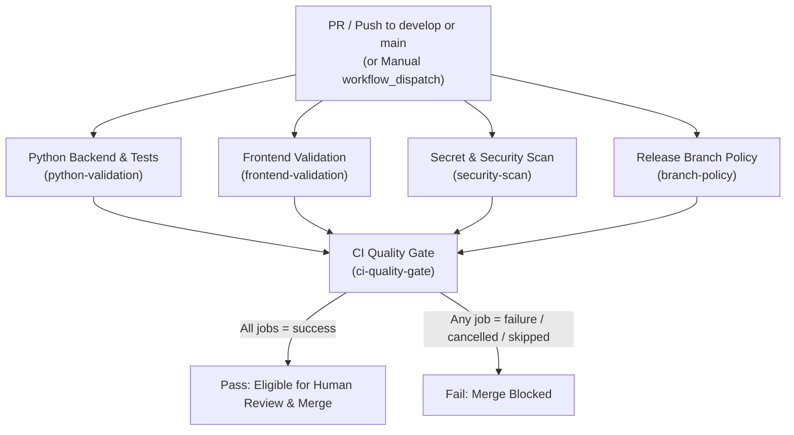

# ChangeGuard AI — Continuous Integration & PR Quality Gates

> **Scope Notice:** This infrastructure provides **Continuous Integration (CI)** and pull request quality gates only. It does **not** perform automated production deployment or automatic branch merges. Explicit human approval remains mandatory for all merges into protected branches.

---

## 1. Purpose of CI

The ChangeGuard AI CI pipeline prevents broken Python syntax, incompatible dependencies, critical lint defects, failing automated tests, committed secrets, and invalid branch promotions from entering the protected `develop` and `main` branches.

Because ChangeGuard AI is a multi-agent system developed concurrently by multiple team members (M1–M4 / A1–A6), CI provides a fast, deterministic, credential-free baseline check on every pull request and every merge.

---

## 2. Workflow Architecture

The workflow is defined in [`.github/workflows/ci.yml`](../.github/workflows/ci.yml) under the workflow name **`ChangeGuard CI`**.



### Job Breakdown

| Job ID | Display Name | What It Checks |
| --- | --- | --- |
| `python-validation` | Python Backend & Tests | Python 3.12 setup, pip cache, dependency install (`project/requirements.txt` when present), `pip check`, AST syntax validation of all `.py` files, Ruff critical correctness checks, `pytest` suite |
| `frontend-validation` | Frontend Validation | Checks for `frontend/package.json`. When absent, reports `not_applicable` cleanly. When present, installs dependencies via lockfile (`npm ci`, `pnpm`, or `yarn`) and runs existing `lint`, `typecheck`, `test`, and `build` scripts |
| `security-scan` | Secret & Security Scan | Scans tracked text files for leaked API keys, tokens, private keys, and committed `.env` files |
| `branch-policy` | Release Branch Policy | For PRs targeting `main`, enforces that the source branch is `develop`, `release/*`, or `hotfix/*` |
| `ci-quality-gate` | **CI Quality Gate** | Final required status check (`if: always()`). Fails if any upstream job fails, is cancelled, or is unexpectedly skipped |

---

## 3. Pull Request Triggers

- Triggers on `pull_request` targeting `develop` or `main`.
- GitHub Actions automatically checks out the synthetic merge commit (`refs/pull/<number>/merge`), validating the proposed merged state against the destination branch.
- Concurrency control (`cancel-in-progress: true` for PRs) cancels superseded CI runs when new commits are pushed to the same PR.
- No workflow-level `paths` filters are used, ensuring **`CI Quality Gate`** always reports on every PR.

---

## 4. Post-Merge Validation

- Triggers on `push` to `develop` and `main` to validate the actual merged branch state.
- Concurrency cancellation is disabled for `push` events (`cancel-in-progress: false`) so post-merge commits are not silently aborted.
- Also supports manual execution via `workflow_dispatch` in the GitHub Actions UI.

---

## 5. Required Status Checks

Configure GitHub branch protection / rulesets to require the single stable check:

- **`CI Quality Gate`**

Because `ci-quality-gate` aggregates all mandatory jobs (`python-validation`, `frontend-validation`, `security-scan`, `branch-policy`), adding future CI checks only requires adding them to `needs:` in `ci-quality-gate` without reconfiguring GitHub branch protection rules.

---

## 6. How Developers Create Feature Branches

All day-to-day development branches off `develop`:

```bash
git fetch origin
git checkout develop
git pull origin develop
git checkout -b feature/<your-short-topic>
```

Naming conventions:
- `feature/<topic>` — new agent or application functionality
- `fix/<topic>` — bug fixes
- `chore/<topic>` — CI, tooling, or maintenance
- `docs/<topic>` — documentation updates

---

## 7. How Developers Submit Pull Requests

1. Push your branch to `origin`:
   ```bash
   git push -u origin feature/<your-short-topic>
   ```
2. Open a Pull Request targeting **`develop`** (never directly to `main` unless releasing from `develop`, `release/*`, or `hotfix/*`).
3. Fill out `.github/pull_request_template.md` completely, including **Component Ownership** and **Integration Impact**.
4. Wait for **`CI Quality Gate`** to pass.
5. Request human review from at least one teammate (two for `main` release PRs).

Normal release workflow:

```
feature/* ──► develop ──► main
```

---

## 8. How to Run Validation Locally

Run the same checks locally before pushing:

```bash
# 1. Dependency compatibility check
python -m pip check

# 2. Python syntax check across the repository
python -c "import ast, pathlib; [ast.parse(p.read_text(encoding='utf-8'), filename=str(p)) for p in pathlib.Path('.').rglob('*.py') if not any(x in p.parts for x in {'.git','.venv','venv','node_modules','__pycache__'})]"

# 3. Critical Ruff lint checks (install ruff first if not installed: pip install ruff)
ruff check --select E9,F63,F7,F82,F811,F404,F406,F407,F601,F602 .

# 4. Run pytest suite (no LLM API keys required)
pytest -v --tb=short
```

On PowerShell (Windows), set `PYTHONPATH` if needed:

```powershell
$env:PYTHONPATH = "."
pytest -v --tb=short
```

---

## 9. How to Interpret Failed CI Jobs

- **Python Backend & Tests failed:**
  - *Syntax step:* Fix the reported `SyntaxError` file and line number.
  - *Ruff step:* Fix undefined names (`F82`), duplicate definitions (`F811`), or invalid imports (`F404`/`F406`/`F407`).
  - *`pip check` step:* Resolve conflicting package versions in `project/requirements.txt`.
  - *`pytest` step:* Inspect the short traceback and reproduce locally with `pytest -v <test_file>`.
- **Frontend Validation failed:**
  - Reproduce in `frontend/` using the package manager indicated by the lockfile (`npm ci`, then `npm run lint` / `typecheck` / `test` / `build`).
- **Secret & Security Scan failed:**
  - Remove any committed `.env` file or hardcoded key immediately. If a real credential was pushed to GitHub, **rotate/revoke it immediately** and purge it from git history.
- **Release Branch Policy failed:**
  - Change the PR base branch from `main` to `develop`, or merge into `develop` first and open a release PR from `develop` to `main`.
- **CI Quality Gate failed:**
  - Check the Job Summary table in the Actions run to see which upstream job failed, was cancelled, or was skipped.

---

## 10. How to Resolve Merge Conflicts

If your PR branch is behind `develop` or has merge conflicts:

```bash
git fetch origin
git checkout feature/<your-short-topic>
git merge origin/develop
# Resolve conflicts in affected files, then run local checks:
pytest -v --tb=short
git add <resolved-files>
git commit -m "merge: resolve conflicts with develop"
git push
```

---

## 11. How to Configure Branch Protection

> **Important:** Creating `.github/workflows/ci.yml` does **not** automatically enable branch protection on GitHub. First merge this workflow into `develop` (and `main`) and trigger at least one CI run so GitHub registers the **`CI Quality Gate`** status check. Then configure repository **Rulesets** (or classic Branch Protection Rules) in **GitHub → Settings → Rules → Rulesets** (or **Settings → Branches**).

### `develop` Branch Rules

- Require a pull request before merging
  - Required approving reviews: **1**
  - Dismiss stale pull request approvals when new commits are pushed: **Enabled**
  - Require conversation resolution before merging: **Enabled**
- Require status checks to pass before merging
  - Require branches to be up to date before merging: **Enabled**
  - Required status check: **`CI Quality Gate`**
- Block force pushes: **Enabled**
- Restrict deletions (block branch deletion): **Enabled**
- Restrict direct pushes via the pull request requirement
- Avoid unnecessary administrator bypasses

### `main` Branch Rules

- Require a pull request before merging
  - Required approving reviews: **2** (where team size and GitHub plan permit; minimum 1 if constrained)
  - Dismiss stale pull request approvals when new commits are pushed: **Enabled**
  - Require conversation resolution before merging: **Enabled**
- Require status checks to pass before merging
  - Require branches to be up to date before merging: **Enabled**
  - Required status check: **`CI Quality Gate`**
- Block force pushes: **Enabled**
- Restrict deletions (block branch deletion): **Enabled**
- Normal release flow: **`develop` → `main`** (enforced in CI by `branch-policy`)
- Explicit human approval required; **no automated production deployment**

### Plan & Permission Notes

- On GitHub Free for **private** repositories, some advanced ruleset/branch-protection options require GitHub Pro, Team, or Enterprise (or a **public** repository). Public repositories have full branch protection and ruleset support.
- Only repository administrators can create or modify branch protection rules and rulesets.

---

## 12. How to Handle Breaking Agent Contracts

When modifying shared schemas in `project/schemas/` or agent input/output contracts (A1–A6 / Orchestrator):

1. Coordinate with affected component owners before changing required fields.
2. Document the contract change in the PR template under **Integration Impact**.
3. Update or add deterministic contract tests under `tests/` using mocked/stubbed agent outputs.
4. Ensure all orchestrator and downstream agent tests pass before requesting merge approval.

---

## 13. How to Handle Flaky Tests

- Mandatory CI tests must be deterministic and offline (no real LLM API calls, no external network dependencies, no wall-clock race conditions).
- Never use `continue-on-error: true` to mask flaky tests.
- If a test exhibits flakiness, isolate the nondeterminism (mock clocks, seeds, temporary directories via `tmp_path`, mocked LLM responses) and fix it immediately.

---

## 14. How to Extend CI When New Agents Are Implemented

As A1–A6, the Central Orchestrator, `project/schemas/`, `sample_projects/mini_pos/`, and `frontend/` are implemented and merged into `develop`:

1. **Dependencies:** Fix the existing malformed `project/requirements.txt │` filename (separate PR) and list runtime dependencies in `project/requirements.txt`. CI will automatically install and verify them with `pip check`.
2. **Unit & Contract Tests:** Add deterministic test modules under `tests/` (e.g., `tests/test_schemas.py`, `tests/test_orchestrator.py`, `tests/test_agents_contracts.py`) covering:
   - Structured input/output schemas and required fields
   - Orchestrator state transitions, handoffs, failure handling, and retry budget (max 2 repair iterations)
   - Human approval gate enforcement and prevention of unauthorized automatic merges
   - Mocked LLM responses (zero real API credentials)
3. **Frontend:** Once `frontend/package.json` and a lockfile are added, `frontend-validation` will automatically install dependencies and execute existing `lint`, `typecheck`, `test`, and `build` scripts.
4. **Live LLM Integration Tests (Optional, Future):** Never add paid/live LLM calls to `ci.yml`. Instead, create a separate `workflow_dispatch`-only workflow restricted to trusted branches with explicit manual approval and repository environment secrets.

---

## 15. Security Restrictions

- Minimal workflow permissions: `contents: read` at both workflow and job levels.
- Uses standard `pull_request` events; **`pull_request_target` is strictly prohibited**.
- No repository secrets are exposed to untrusted PR runs.
- All third-party GitHub Actions are pinned to verified full 40-character commit SHAs.
- Checkout disables credential persistence (`persist-credentials: false`).
- Untrusted PR metadata (`github.head_ref`, PR titles, commit messages) is never interpolated directly into shell commands; values are passed via `env:` variables.
- Hosted `ubuntu-latest` runners only (no self-hosted runners for untrusted PRs).
- Secret scanning fails the build on committed `.env` files or high-confidence secret patterns without printing secret values.

---

## 16. Known Limitations

- **Malformed `project/requirements.txt │` filename:** As of initial CI setup on `develop`, `project/requirements.txt │` contains a trailing space and Unicode character (`U+2502`). CI emits a warning until this is renamed to `project/requirements.txt` in a dedicated fix PR.
- **Unimplemented agents & orchestrator on `develop`:** Multi-agent contract tests and orchestrator state-machine tests cannot be executed until those modules are merged into `develop`.
- **Unimplemented frontend on `develop`:** `frontend/` currently contains only `.gitkeep`; `frontend-validation` reports `not_applicable` until `frontend/package.json` is added.
- **No automated deployment:** By design, CI validates code quality and integration safety only.
- **GitHub Actions execution requires push/PR:** Local verification validates syntax, YAML structure, and tests, while full GitHub Actions runner execution and branch protection enforcement must be verified once pushed to GitHub.
