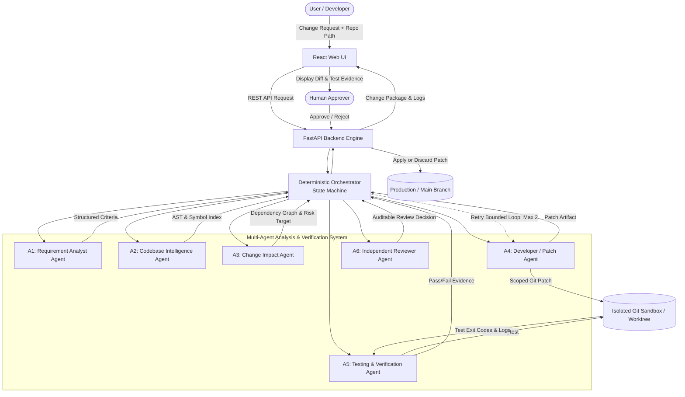
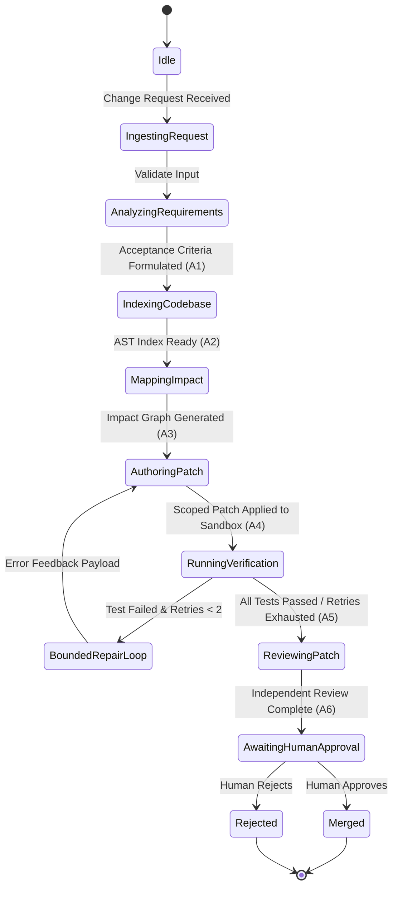
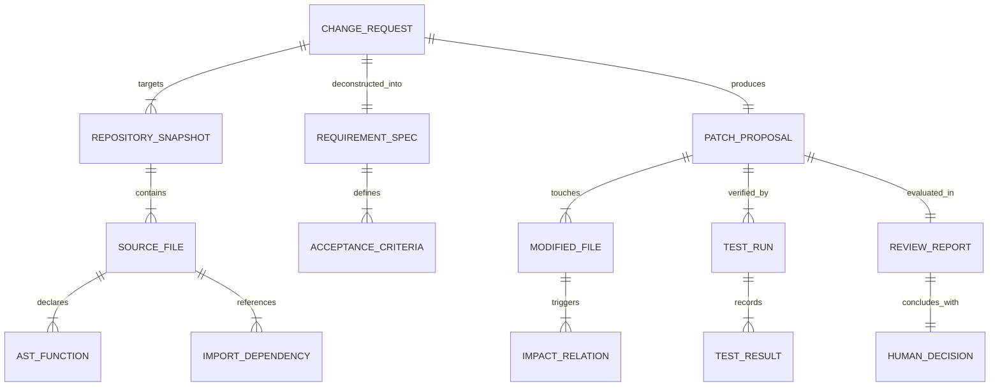
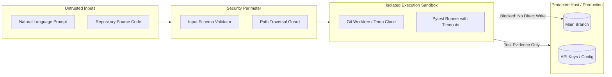

# ChangeGuard AI — System & Technical Architecture

## 1. High-Level Architecture Overview

ChangeGuard AI is architected as an **evidence-driven multi-agent verification system** governed by a **deterministic state machine orchestrator**. Unlike open-ended conversational agent swarms, ChangeGuard AI uses strict agent handoffs, bounded feedback loops, structured JSON communication payloads, and mandatory human sign-off.



---

## 2. Component Architecture & Specialization

The architecture decouples responsibilities into distinct specialist agents to eliminate role interference and prevent confirmation bias during code verification.

### 2.1 The Six Specialist Agents

| Agent Identifier | Formal Agent Name | Core Responsibilities | Input Artifacts | Output Artifacts |
| :--- | :--- | :--- | :--- | :--- |
| **A1** | **Requirement Analyst** | Parses natural-language change requests, extracts business intent, defines explicit acceptance criteria, lists assumptions, and identifies potential edge cases. | Natural language prompt, Project README/docs | `RequirementSpecification` (JSON criteria, constraints, assumptions) |
| **A2** | **Codebase Intelligence** | Indexes Python codebases using Abstract Syntax Trees (`ast`), extracts function signatures, class hierarchies, and imports. | Repository file path | `CodebaseIndex` (File map, AST symbol table, import declarations) |
| **A3** | **Change Impact** | Builds a reverse dependency graph from import declarations; executes Breadth-First Search (BFS) to map direct and indirect module dependents; correlates Git diff lines to AST function nodes. | `CodebaseIndex`, Git diff / target file | `ImpactReport` (Direct/indirect affected files, dependency depth, affected functions) |
| **A4** | **Developer Agent** | Generates minimal, scoped code modifications inside an isolated Git worktree or branch. Strictly restricted from modifying untouched modules without justification. | `RequirementSpecification`, Target files, `ImpactReport` | `GitDiffPatch` (Unified diff, list of modified files/lines) |
| **A5** | **Testing Agent** | Formulates new acceptance test cases matching A1's criteria; triggers pre-existing regression test suites in an isolated sandbox (`pytest`); parses execution logs. | `GitDiffPatch`, Regression test suite, Acceptance criteria | `TestExecutionLog` (Pass/fail counts, stack traces, regression safety verification) |
| **A6** | **Independent Reviewer** | Adversarial validation agent. Cross-checks generated diff against original requirements, verifies test coverage, inspects patch scope, and detects hallucinated modifications. | All previous artifacts | `ReviewRecommendation` (ACCEPT, REJECT, or NEEDS_HUMAN_REVIEW with rationale) |

---

## 3. Communication Architecture & Protocol

### 3.1 Structured Records vs. Free-Form Chat
ChangeGuard AI strictly rejects unstructured, conversational LLM message chains. Inter-agent communication is mediated by the deterministic orchestrator using immutable, typed JSON records.

```json
{
  "task_id": "TASK-20261124-POS-01",
  "stage": "impact_analysis",
  "status": "completed",
  "agent": "CodebaseIntelligenceAgent",
  "inputs": {
    "repository_root": "sample_projects/mini_pos",
    "changed_file": "billing.py"
  },
  "outputs": {
    "changed_functions": ["apply_discount"],
    "impact_analysis": {
      "direct_count": 2,
      "indirect_count": 2,
      "potentially_impacted_files": [
        {"file": "refunds.py", "impact_level": "direct", "dependency_depth": 1},
        {"file": "reports.py", "impact_level": "direct", "dependency_depth": 1},
        {"file": "customer_service.py", "impact_level": "indirect", "dependency_depth": 2},
        {"file": "dashboard.py", "impact_level": "indirect", "dependency_depth": 3}
      ]
    }
  },
  "evidence_references": [
    "sample_projects/mini_pos/refunds.py#L1",
    "sample_projects/mini_pos/reports.py#L1"
  ],
  "confidence_score": 1.0,
  "uncertainty_notes": []
}
```

### 3.2 State Machine Lifecycle
The orchestrator drives a finite state machine (FSM):



---

## 4. Data Architecture & Entity Relationships

The data architecture handles state across static AST representations, dependency graphs, test outputs, and audit logs.



### Key Data Entities
1. **`RequirementSpecification`:** Contains `requirement_id`, `raw_text`, `acceptance_criteria` list, `assumptions` list, `in_scope_modules`, and `out_of_scope_modules`.
2. **`CodebaseIndex`:** Contains dictionary of files, list of functions per file, list of classes, and list of imports (parsed via Python's standard `ast` library).
3. **`ReverseDependencyGraph`:** Adjacency list mapping each imported target module to all source files that import it, including line numbers of import statements.
4. **`PatchArtifact`:** Stores base commit hash, working branch name, unified Git diff string, list of modified line ranges, and AST function overlap mapping.
5. **`VerificationEvidence`:** Contains test execution stdout/stderr, test exit codes, pytest summary counts (passed, failed, skipped), runtime duration, and regression safety flag.

---

## 5. Security & Isolation Architecture

ChangeGuard AI is architected around strict zero-trust boundaries to prevent prompt injections, arbitrary code execution, and data corruption:



### Security Safeguards
1. **Isolated Worktrees:** Code modifications are never applied to the active repository working copy or `main` branch. A dedicated Git worktree or temporary clone directory is created for patch application and testing.
2. **Path Traversal Protection:** All file paths are resolved and checked using `pathlib.Path.resolve()`. Absolute paths outside the designated repository or paths containing `..` trigger immediate exceptions (`ValueError: Use a relative repository file path`).
3. **Restricted Command Execution:** Arbitrary shell execution is forbidden. Only explicit allowlisted commands (`git diff`, `git status`, `pytest -q`) are invoked via Python's `subprocess.run` with array arguments (preventing shell injection) and strict timeouts.
4. **No Arbitrary Dependency Installations:** The system does not run `pip install` on untrusted packages during automated test execution.
5. **Human-in-the-Loop Sign-Off:** No patch is ever automatically committed to `main` or pushed to remote repositories. The final transition from patch artifact to repository update requires explicit human action.

---

## 6. Runtime Architecture & Execution Layout

### 6.1 Process Layout & Ports (Target Full Stack)
- **Frontend App:** React SPA running on Node/Vite development server at `http://localhost:3000` (or `5173`).
- **Backend API:** FastAPI application running on Uvicorn server at `http://localhost:8000`.
- **Worker Execution:** Subprocess orchestration invoked asynchronously via FastAPI background tasks or dedicated process workers.

### 6.2 Existing Implemented Core (Repository Evidence)
In the current implementation (`feature/mujahidh-codebase`), the codebase intelligence pipeline runs as standalone Python modules:
- Entry point: `project/agents/mujahidh_codebase/codebase_agent.py`
- Core functions executed in memory:
  - `analyzer.py:analyze_repository(source_root)`
  - `git_diff_analyzer.py:changed_functions(git_root, base_ref)`
  - `impact_agent.py:analyze_impact(source_root, relative_file)`
