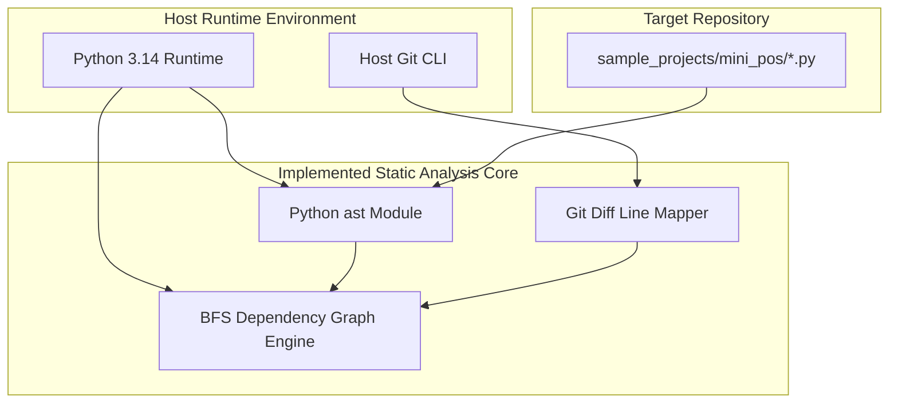

# ChangeGuard AI — Technology Stack Inventory

This document provides a complete inventory of technologies, libraries, frameworks, and tools specified in the proposal and implemented in the repository.

---

## 1. Technology Classification Matrix

| Technology | Layer | Status in Repo | Primary Purpose in Project | Configuration / Reference File |
| :--- | :--- | :--- | :--- | :--- |
| **Python 3.10+ (3.14 runtime)** | Core Language | **Implemented** | Core execution runtime for agents, analyzers, and backend logic. | `project/agents/mujahidh_codebase/*.py` |
| **Python standard `ast`** | Static Analysis | **Implemented** | Syntactic parsing of Python source code into abstract syntax trees without executing code. | `project/agents/mujahidh_codebase/analyzer.py`, `impact_agent.py` |
| **Git CLI (subprocess)** | Version Control | **Implemented** | Repository diff analysis, tracking modified lines, and managing worktree sandboxes. | `project/agents/mujahidh_codebase/git_diff_analyzer.py` |
| **`collections.deque`** | Data Structures | **Implemented** | Breadth-First Search queue for reverse dependency graph traversal. | `project/agents/mujahidh_codebase/impact_agent.py` |
| **FastAPI** | Backend Web API | Proposed / Scaffolding | REST API exposing endpoints to manage change requests, trigger agents, and view audit reports. | `project/main.py` |
| **Pydantic** | Data Validation | Proposed / Scaffolding | Strict typing and validation for inter-agent structured JSON communication payloads. | `project/schemas/` |
| **React + Tailwind CSS** | Frontend Dashboard | Proposed / Scaffolding | Visual user interface displaying change requests, agent timelines, diffs, and approval controls. | `frontend/` |
| **pytest** | Test Framework | Proposed / Scaffolding | Automated execution of acceptance tests and regression test suites inside isolated environments. | `tests/`, `sample_projects/mini_pos` |
| **NetworkX** | Graph Analytics | Proposed Alternative | Alternative/supplementary graph analysis library for dependency topological sorting. | Proposal Section 6 |
| **SQLite + JSON Logs** | Data Persistence | Proposed / In Progress | Lightweight persistent storage for task audit records, benchmark metrics, and execution history. | Proposal Section 6 |
| **Docker (optional sandbox)** | Isolation | Proposed Sandbox | Containerized isolation for executing untrusted repository code and test suites. | Proposal Section 6 |
| **Configurable LLM APIs** | Agent Reasoning | Proposed Integration | Underlying LLM provider for Requirement Analyst, Developer, and Reviewer agents. | Proposal Section 6 |

---

## 2. Deep Dive: Core Implemented Technologies

### 2.1 Python `ast` (Abstract Syntax Tree)
- **What it is:** A built-in Python module that parses Python source code into a grammar-accurate tree structure representing syntactic constructs (modules, classes, functions, statements, imports).
- **Where it is used:** `analyzer.py`, `git_diff_analyzer.py`, and `impact_agent.py`.
- **Why it is used:**
  - **Zero Security Risk:** Parsing an AST does **not** execute the code. Untrusted or malicious code in a target repository cannot exploit the host during AST analysis.
  - **Precision:** AST traversal directly maps lines of code to enclosing function definitions, eliminating fragile regular expression matching.
  - **Zero Dependencies:** Requires no third-party package installation; built into the Python runtime.

### 2.2 Git CLI & `subprocess.run`
- **What it is:** Invoking the local system's Git command-line tool via Python's `subprocess` module.
- **Where it is used:** `project/agents/mujahidh_codebase/git_diff_analyzer.py`.
- **Why it is used:**
  - Standardized unified diff generation (`git diff --unified=0`).
  - Allows checking unstaged, staged, or committed changes against any base reference (`HEAD`, `main`).
  - Native performance and exact parity with developer Git workflows.

### 2.3 Breadth-First Search (BFS) Dependency Graph
- **What it is:** Custom graph traversal algorithm using `collections.deque` and an in-memory inverted adjacency list.
- **Where it is used:** `project/agents/mujahidh_codebase/impact_agent.py`.
- **Why it is used:**
  - Computes transitive dependencies cleanly across arbitrary depths.
  - Categorizes immediate dependents as `direct` (depth 1) and transitive dependents as `indirect` (depth > 1).
  - Maintains `visited` set to gracefully handle circular or recursive module imports without stack overflow.

---

## 3. Technology Interactions & Communication Bridges

---

## 4. Environment & Tooling Anomalies

- **Filename Typo in `project/requirements.txt │`:**
  - The repository contains a file named `"requirements.txt \342\224\202"` where a Unicode vertical box character (`│`) was inadvertently appended.
  - While harmless on modern POSIX filesystems, it can cause command-line confusion on Windows (`pip install -r requirements.txt` fails because the file on disk has the trailing character).
  - **Recommendation:** Rename to standard `requirements.txt`.
