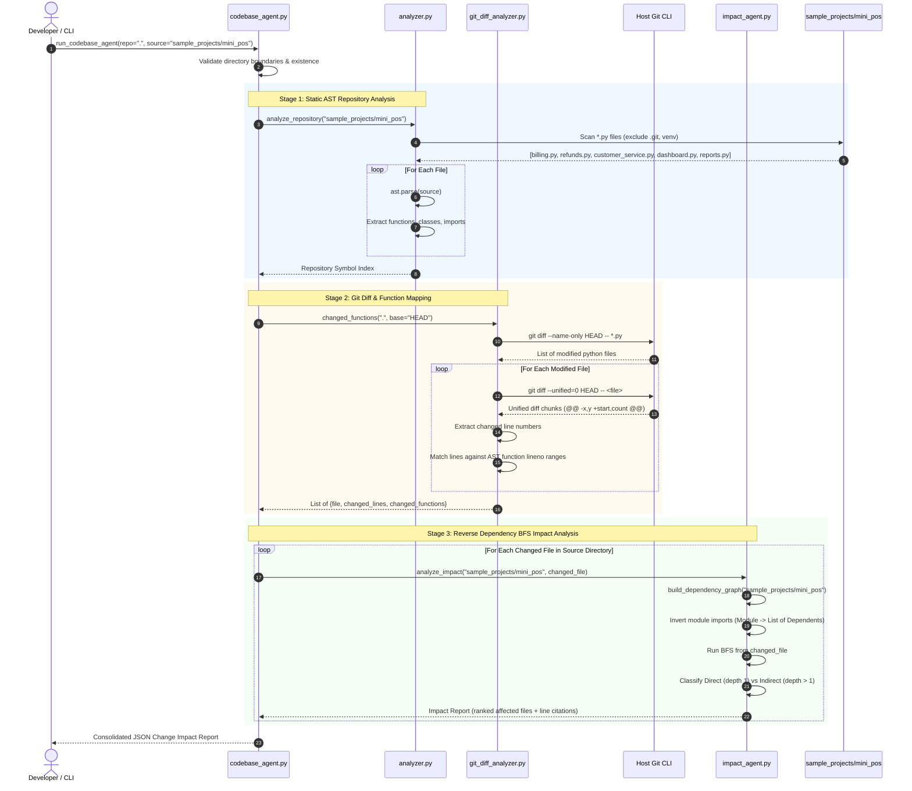

# ChangeGuard AI — End-to-End Execution Workflows

This document details both the **Actual Implemented Execution Workflow** (as verified in the code) and the **Full Intended System Workflow** (as defined in the proposal and architecture).

---

## 1. Actual Implemented Execution Workflow (Codebase & Impact Analysis)

In the current implementation (`feature/mujahidh-codebase`), the end-to-end execution path for static code analysis, diff detection, and impact mapping is operational.



### 1.1 Detailed Execution Trace (Line-by-Line)
1. **Trigger:** `python -m project.agents.mujahidh_codebase.codebase_agent` (or invocation of `run_codebase_agent()`).
2. **Path Sanitization:** `codebase_agent.py#L24-L35` asserts `git_root.is_dir()`, `source_root.is_dir()`, and `source_root.is_relative_to(git_root)`. Prevents directory breakout.
3. **AST Repository Indexing:** `analyzer.py#L12-L69` calls `analyze_repository()`. Recursively discovers files in `sample_projects/mini_pos/`. Constructs symbol definitions:
   - `billing.py`: Functions `apply_discount`, `calculate_total`, `checkout`.
   - `refunds.py`: Function `calculate_refund`; Imports `billing`.
   - `customer_service.py`: Function `process_customer_refund`; Imports `refunds`.
   - `dashboard.py`: Function `display_refund`; Imports `customer_service`.
   - `reports.py`: Function `generate_sales_report`; Imports `billing`.
4. **Git Modification Check:** `git_diff_analyzer.py#L20-L75` executes `git diff` against `HEAD`. If `billing.py` has uncommitted changes in `apply_discount()`, regex extracts the line numbers, walks the AST, and binds the change specifically to `apply_discount`.
5. **Reverse Dependency Traversal:** `impact_agent.py#L82-L162` runs `analyze_impact()`. Using BFS traversal:
   - Direct impact (Depth 1): `refunds.py` (line 1), `reports.py` (line 1).
   - Indirect impact (Depth 2): `customer_service.py` (line 1, via `refunds.py`).
   - Indirect impact (Depth 3): `dashboard.py` (line 1, via `customer_service.py`).
6. **Result Generation:** Formats complete JSON report containing total impacted modules (4), direct count (2), and indirect count (2).

---

## 2. Full Intended System Workflow (End-to-End Multi-Agent Lifecycle)

The complete end-to-end operational lifecycle when all agents are integrated:

```mermaid
sequenceDiagram
    autonumber
    actor User as User / Developer
    participant UI as React Web Dashboard
    participant API as FastAPI Backend
    participant Orch as Deterministic Orchestrator
    participant A1 as A1: Requirement Analyst
    participant A23 as A2/A3: Codebase & Impact
    participant A4 as A4: Developer Agent
    participant Sandbox as Isolated Worktree Sandbox
    participant A5 as A5: Testing Agent
    participant A6 as A6: Independent Reviewer

    User->>UI: Submit Change Request ("10% discount for premium customers")
    UI->>API: POST /api/tasks {prompt, repo_path}
    API->>Orch: Initialize Task (Generate TaskID)
    
    Orch->>A1: Deconstruct prompt
    A1-->>Orch: Structured Acceptance Criteria + Assumptions
    
    Orch->>A23: Analyze Codebase & Impact
    A23-->>Orch: Target: billing.py; Direct: refunds.py, reports.py; Indirect: customer_service.py, dashboard.py
    
    Orch->>Sandbox: Create isolated temporary Git worktree
    
    rect rgb(255, 245, 245)
        note over Orch,A5: Bounded Patch & Verification Loop (Max 2 Retries)
        Orch->>A4: Request scoped patch for billing.py (Criteria + AST context)
        A4->>Sandbox: Apply patch diff to billing.py
        A4-->>Orch: Scoped Git Diff Patch
        
        Orch->>A5: Verify patch (Acceptance criteria + Existing tests)
        A5->>Sandbox: Execute pytest in sandbox
        Sandbox-->>A5: Exit codes, test output, pass/fail counts
        
        alt Tests Fail and Retries < 2
            A5-->>Orch: Test Failure Logs (Regression in reports.py)
            Orch->>A4: Repair Request with Test Failure Trace
            A4->>Sandbox: Adjust patch in sandbox
            A4-->>Orch: Updated Git Diff Patch
            Orch->>A5: Re-run pytest
            Sandbox-->>A5: All tests pass
        end
        A5-->>Orch: Verification Evidence (Regression-Safe: True)
    end

    Orch->>A6: Adversarial Review (Verify scope, criteria, diff, tests)
    A6-->>Orch: Review Recommendation: "ACCEPT / READY_FOR_HUMAN_APPROVAL"
    
    Orch-->>API: Task Completed (Package Artifacts)
    API-->>UI: Display Change Package (Diff, Impact Graph, Test Logs)
    
    User->>UI: Review Diff and Test Evidence
    alt Human Approves
        User->>UI: Click "Approve & Apply"
        UI->>API: POST /api/tasks/{id}/approve
        API->>TargetRepo: Merge patch into working branch
        API-->>UI: Confirmation (Merged)
    else Human Rejects
        User->>UI: Click "Reject"
        UI->>API: POST /api/tasks/{id}/reject
        API->>Sandbox: Discard temporary worktree
        API-->>UI: Confirmation (Discarded)
    end
```

---

## 3. Failure & Exception Handling Paths

| Failure Scenario | Detecting Component | Mitigation & Recovery Path |
| :--- | :--- | :--- |
| **Invalid Repository Path** | `analyzer.py` / `codebase_agent.py` | Raises `ValueError("Repository not found")`; Backend returns `400 Bad Request` with clear remediation instructions. |
| **Path Traversal Attack (`../`)** | `impact_agent.py` | Detects `..` in path components; raises `ValueError("Use a relative repository file path")` before filesystem access. |
| **Python Syntax Error in Repo** | `analyzer.py` | AST parser catches `SyntaxError` or `UnicodeError`; isolates error to that file's report and continues scanning remaining files. |
| **Patch Introduces Regressions** | `A5 Testing Agent` | Captured via `pytest` non-zero return code. Passed back to `A4 Developer Agent` with failure log for bounded auto-repair (max 2 iterations). |
| **Scope Creep / Over-Editing** | `A6 Reviewer Agent` | Compares modified files in Git diff against `ImpactReport`. If developer agent modified files outside the identified scope, flags `REJECT: Patch modified unapproved files`. |
| **Unresponsive LLM / Timeout** | `Orchestrator` | Subprocess and API calls enforce strict timeouts (30–60s); halts task, logs timeout error, and returns graceful failure without corrupting Git state. |
